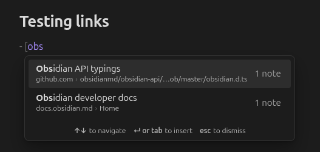

# External Link Autocomplete

Reuse the external links you've already written, without hunting for the URL again.

Start a Markdown link with `[` and type part of its text. External Link Autocomplete suggests matching links from anywhere in your vault, and accepting one inserts the whole link: type `[jira`, press Enter, and get `[Jira board](https://example.atlassian.net/…)`.

## Features

- **Autocomplete.** Suggestions for links you've already used, as you type.
- **Link browser.** Every external link in your vault in one view, with the notes that use it.
- **Edit a link across the vault.** Change a link's text or URL in every note at once, after a preview, and undo it if needed.
- **External links in each note.** A list at the end of every note of the links it uses, next to its backlinks.
- **Desktop and mobile**, fully local.

## Autocomplete

1. In a note, type `[` followed by at least two characters of a link text you've used before.
2. Pick a suggestion with the arrow keys and press **Enter** or **Tab**, or click or tap it.
3. The full link is inserted, replacing what you typed (including an auto-paired `]`), and the cursor moves to just after it.

Press **Esc** to dismiss the suggestions. They stay closed until you start a new link.

- **Suggestions from your own vault.** Every `[text](https://…)` link in your notes becomes a suggestion, keyed by its text.
- **Smart matching.** Exact matches come first, then matches at the start of the text (`[jira` → "Jira board"), then at the start of any word (`[board` → "Jira board"), then looser matches. Case and accents don't matter: `[cafe` finds "Café".
- **Sensible ranking.** Among equally good matches, links you use in more notes, and in notes you edited recently, come first.
- **Every URL a text has pointed to.** If "Docs" has linked to two different sites, you get a row for each, told apart by host and path.
- **Native look and feel.** The popup matches Obsidian's own suggestions and follows your theme.
- **Stays out of your way.** No suggestions inside `[[` wikilinks, `![` images, `[^` footnotes, `- [ ]` task boxes, code or frontmatter. Links are indexed in the background and kept up to date as you edit, rename and delete notes.

## Link browser

Run **Open link browser** to see every external link in the vault, with how many notes use it. It opens in the sidebar at first; drag it into a tab or to the other sidebar, and it reopens wherever you left it.

- **Group by URL or by text.** By URL, each URL lists the texts it's written with; by text, each text lists the URLs it points to. Expand a row to see its notes, and a note to see the lines with the link. Click a line to jump to it, or Ctrl/Cmd-click to open it in a new tab.
- **Sort** by most notes, name or recently used, and **filter** by text or URL.
- **Only inconsistent** keeps the URLs written with several texts (or texts pointing to several URLs), which is where tidying up a vault starts.

## Edit a link across the vault

Rename a link's text or change its URL in every note that uses it. Run **Edit link across vault** with the cursor on a link, right-click a link in a note, or right-click a row in the link browser or in a note's external links (long-press on mobile).

- The dialog shows every affected line before anything changes, and the button says how many links it will update.
- **Also update other texts for this URL** unifies every text a URL is written with in one go.
- Notes you have open are edited in place, so unsaved typing is kept and Ctrl/Cmd+Z works there. Links in code blocks and frontmatter are never touched.
- **Undo last link edit** puts the links back, skipping any you've changed since. It's available until you close Obsidian.

## External links in each note

At the end of every note, an **External links** section lists the links the note uses, one row per URL, with its texts and how many notes in the vault use it. With Obsidian's "Backlink in document" on, it sits next to "Linked mentions" and "Unlinked mentions"; otherwise it follows the note's text. It works in Live Preview, Source mode and reading view.

Click a row to jump to the link, or its address to open it in your browser. Click the header to collapse it in every note. Turn it off with **Show external links in notes**.

## Commands

| Command | What it does |
|---|---|
| Open link browser | Opens the link browser, or reveals it if it's already open. |
| Edit link across vault | Edits the link under the cursor in every note. |
| Undo last link edit | Reverts the last vault-wide edit. Only shown when there's one to undo. |
| Rebuild link index | Scans the vault again. Only needed if suggestions look out of date. |

None has a default hotkey; assign one under **Settings → Hotkeys**.

## Settings

| Setting | What it does |
|---|---|
| Minimum characters | How many characters after `[` before suggestions appear. Default 2. |
| Ranking | Balanced (default), most used, or most recent. |
| When a text has several links | Show all (default), only the most recent, or only the most used. |
| Accept with tab | Tab inserts the selected suggestion, as Enter does. On by default. |
| Show note count | Shows how many notes use each link in the suggestions. |
| Show external links in notes | Lists a note's external links at its end. On by default. |
| Ignored link texts | Texts that are never suggested. Defaults to here, link, this, source and click here. |
| Ignored domains | Domains that are never suggested. `*` matches anything, as in `*.internal.example.com`. |
| Excluded folders | Folders whose links are never suggested. |
| Rebuild index | Scans the vault again, like the **Rebuild link index** command. |

## Privacy

Everything stays on your device. The plugin reads your notes to build an in-memory index of the links in them, and makes no network requests: no telemetry, no favicons, no page-title fetching.

## Installation

From Obsidian: open **Settings → Community plugins → Browse**, search for "External Link Autocomplete", then install and enable it.

Manually: download `main.js`, `manifest.json` and `styles.css` from the [latest release](https://github.com/brunoribeiro2k/obsidian-external-link-autocomplete/releases/latest) into `<your vault>/.obsidian/plugins/external-link-autocomplete/`, then enable the plugin under **Settings → Community plugins**.

Requires Obsidian 1.13 or later.

## Compatibility with other plugins

Obsidian shows one suggestion popup at a time. If another plugin also offers suggestions after a plain `[`, whichever plugin Obsidian asks first wins. External Link Autocomplete only claims a `[` when it has suggestions to show, so it never blocks another plugin otherwise.

## Contributing

Bug reports and ideas are welcome in [issues](https://github.com/brunoribeiro2k/obsidian-external-link-autocomplete/issues). For development, run `make` to list the commands; [`docs/design.md`](docs/design.md) describes how the plugin works.

## License

[MIT](LICENSE)
